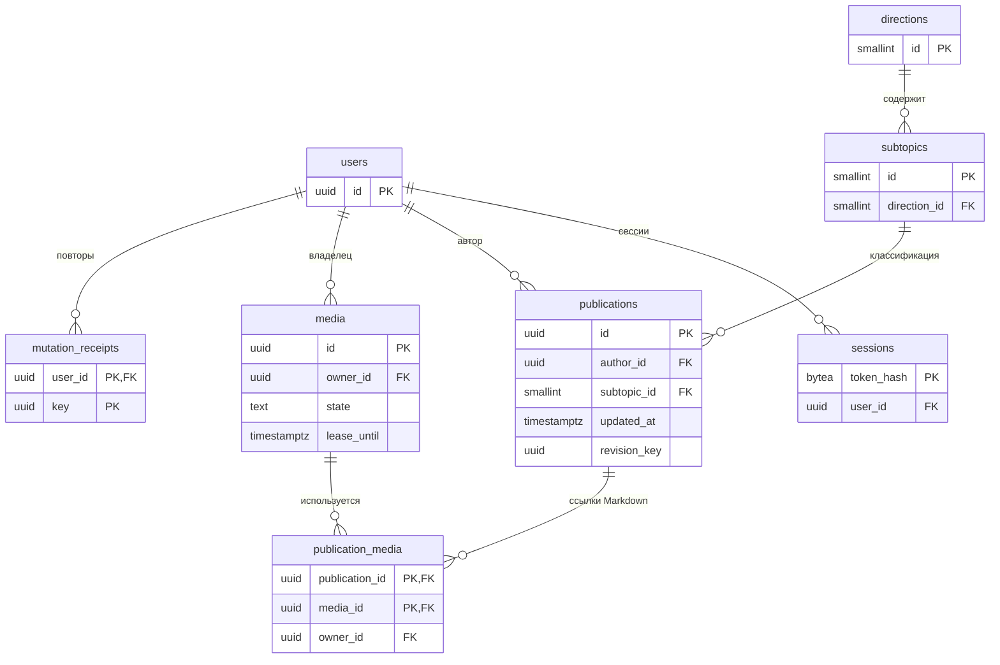

# 02. Схема PostgreSQL

**Дата:** 28.10.2026. **Статус:** техническое решение этапа 2.3.1; физическая схема реализуется миграциями части 1. Наличие таблиц не означает готовности API.

**Кому обязательно прочитать:** разработчику сайта; тестировщику — ограничения и транзакции.
**Какие разделы особенно важны:** 1–4 для миграций, 5–7 для обработчиков/проверок. Разработчику бота достаточно знать: модуль не обращается к этой БД.

Основание: [REQ-ARTICLE, DATE, STATE, MEDIA](../../../TZ_2_1_BLOG_REQUIREMENTS.md). Исполняемый источник структуры после настройки — [001_schema.sql](../../../backend/migrations/001_schema.sql); начальные данные — [002_catalog.sql](../../../backend/migrations/002_catalog.sql). Изменение схемы оформляется новой миграцией и обновлением этого документа.

## 1. Общие правила

PostgreSQL 18, UTF-8. UUID для пользователей, публикаций, изображений и технических ключей; smallint для небольшого фиксированного каталога. Время — `timestamptz`, сервер/соединение работают в UTC; интерфейс преобразует в Europe/Moscow. Все поля в таблицах ниже **NOT NULL**, кроме явно помеченных «NULL». `PK` — первичный ключ, `UQ` — уникальность, `FK` — внешний ключ.

Текст заголовка/имени обрезается по краям в API. Ограничения БД проверяют непустоту `btrim`, длину и допустимые значения; лимиты символов — Unicode-символы (`char_length`), байтов — `octet_length`. UUID создаёт Go через криптографический генератор; для служебных SQL-вставок допустим `gen_random_uuid()`. Каталог меняется миграциями, пользовательского CRUD для него нет.

## 2. Справочники, пользователи и сессии

### `users`

| Поле | Тип / значение по умолчанию | Ограничение |
| --- | --- | --- |
| id | uuid | PK |
| login | text | UQ, `^[a-z][a-z0-9_]{2,31}$`; хранится в нижнем регистре |
| display_name | text | 1–100 символов, непустое |
| password_hash | text, NULL | PHC-строка Argon2id; NULL означает, что вход ещё не настроен |
| is_active | boolean, false | При true password_hash обязателен; непустой hash если задан |

Пять записей: Фёдор Маврин (`fmavrin`), Александр Комаров (`akomarov`), Екатерина Кондратьева (`ekondrateva`), Андрей Воропаев (`avoropaev`), Егор Мушкетов (`emushketov`). UUID фиксированы в миграции. Это локальные логины сайта, не GitHub-аккаунты. Роли команды не сохраняются как полномочия. В части 1 аккаунты неактивны, паролей нет; служебная CLI установки/сброса паролей относится к части 2. Не создаём известные всем пароли в SQL.

### `directions` и `subtopics`

| Таблица | Поля | Ограничения |
| --- | --- | --- |
| directions | id smallint PK; name text; position smallint | name UQ, 1–200 символов; position UQ > 0 |
| subtopics | id smallint PK; direction_id smallint FK directions; name text; position smallint | name 1–300; UQ(direction_id,name); UQ(direction_id,position), position > 0 |

Все удаления справочников — RESTRICT. Направление статьи вычисляется через подтему, отдельного `direction_id` в публикации нет: противоречивую пару нельзя записать. Начальный набор — пять блоков и пятнадцать исходных подтем из PROJECT_CONTEXT §5; это стартовый каталог, а учебные недели не становятся дополнительными обязательными сущностями.

### `sessions`

| Поле | Тип | Ограничение |
| --- | --- | --- |
| token_hash | bytea | PK, ровно 32 байта SHA-256 случайного cookie-токена |
| user_id | uuid | FK users, ON DELETE CASCADE |
| csrf_token | text | 64 hex-символа, случайные 32 байта |
| created_at | timestamptz DEFAULT now() | техническое время |
| expires_at | timestamptz | > created_at; абсолютный срок 7 суток |

Индексы user_id и expires_at. Пароль и исходный токен cookie не хранятся в открытом виде. CSRF-токен не является самостоятельным средством входа. Служебный сброс пароля отзывает все сессии пользователя; истёкшие удаляются обслуживанием.

## 3. Публикации и файлы

### `publications`

| Поле | Тип / default | Ограничение |
| --- | --- | --- |
| id | uuid | PK |
| author_id | uuid | FK users RESTRICT |
| subtopic_id | smallint | FK subtopics RESTRICT |
| title | text | непустой, 1–200 символов |
| markdown | text | непустой, ≤ 200 000 символов и ≤ 800 000 байт |
| updated_at | timestamptz DEFAULT now() | единственная дата материала; задаётся сервером при каждой успешной записи |
| revision_key | uuid | непрозрачный ключ текущего состояния для ETag; меняется при записи |

UQ(id, author_id) для составной связи с медиа. Индексы `(updated_at DESC,id DESC)`, `(author_id,updated_at DESC,id DESC)`, `(subtopic_id,updated_at DESC,id DESC)`. Расширение `pg_trgm`, GIN-индекс выражения `(title || E'\n' || markdown) gin_trgm_ops` для поиска подстроки через ILIKE. Сортировка всегда по updated_at и id, включая поиск. Нет created_at, draft, версии текста, таблицы диалогов или отдельной сущности отчётности.

`revision_key` хранит только текущий случайный токен, а не предыдущий текст/номер версии. Он нужен, чтобы две вкладки не затёрли друг друга незаметно. При одинаковом времени updated_at ключ всё равно различается.

### `media`

| Поле | Тип / default | Ограничение |
| --- | --- | --- |
| id | uuid | PK; одновременно upload_id из API |
| owner_id | uuid | FK users RESTRICT |
| storage_key | text | UQ; `<uuid>.png`, `.jpg` или `.webp`, проверка формата CHECK |
| original_name | text | 1–255 символов; только для сведения, не путь |
| mime_type | text | enum CHECK: image/png, image/jpeg, image/webp |
| byte_size | bigint | 1…5 242 880 |
| width, height | integer | > 0, `width::bigint * height <= 20000000` |
| sha256 | bytea | 32 байта; контроль повторной загрузки/копии |
| state | text, 'staging' | staging / ready / deleting |
| uploaded_at | timestamptz DEFAULT now() | техническое время |
| lease_until | timestamptz | ≥ uploaded_at; защита открытого редактора/срок уборки |

UQ(id,owner_id). Индексы `(owner_id)` и `(lease_until) WHERE state IN ('staging','ready','deleting')`. Для временного файла нет отдельного флага public: общедоступен только `ready` с действующей связью с публикацией. Иначе его получает лишь владелец при неистёкшей аренде. `deleting` и `staging` не выдаются.

### `publication_media`

| Поле | Тип | Ограничение |
| --- | --- | --- |
| publication_id | uuid | часть PK |
| media_id | uuid | часть PK |
| owner_id | uuid | NOT NULL |

PK(publication_id,media_id). Составные FK `(publication_id,owner_id) → publications(id,author_id) ON DELETE CASCADE` и `(media_id,owner_id) → media(id,owner_id) ON DELETE RESTRICT`. Индекс media_id для выдачи и очистки. Один автор может использовать свой файл в нескольких своих статьях. Чужой публичный файл можно смотреть, но нельзя присоединить к своей статье: загружается собственная копия. Это техническое правило владения, исключающее зависимость чужой статьи от управления файлом его владельцем.

Повтор одной картинки в тексте создаёт одну связь. Alt-текст, подписи и положение живут в Markdown, а не в таблице файлов. БД гарантирует владельца и FK, но соответствие ссылок Markdown и состояние ready проверяет транзакция приложения.

## 4. Технические подтверждения запросов

`mutation_receipts` предотвращает повторную публикацию/обновление/удаление после потери ответа. Не хранит Markdown или старые ответы.

| Поле | Тип / default | Ограничение |
| --- | --- | --- |
| user_id | uuid | FK users ON DELETE CASCADE; часть PK |
| key | uuid | Idempotency-Key; часть PK |
| request_hash | bytea | SHA-256, 32 байта, включает method, path, If-Match и каноническое тело |
| resource_id | uuid | ID публикации; без FK, чтобы переживать её удаление |
| result_revision | uuid, NULL | ключ успешной записи; NULL для DELETE |
| status_code | smallint | 200 / 201 / 204; при 204 result_revision NULL, иначе NOT NULL |
| created_at | timestamptz DEFAULT now() | техническое время |
| expires_at | timestamptz | > created_at, 7 суток |

PK(user_id,key), индекс expires_at. Успешная мутация и квитанция пишутся в одной транзакции. Неуспешная транзакция не оставляет квитанцию. Повтор с тем же hash возвращает тот же короткий ответ; другой hash — 409. Гарантия повторов ограничена 7 сутками, затем интерфейс предлагает проверить каталог, а не вслепую повторяет. Авторизация проверяется и при повторе. Квитанция не восстанавливает удалённую статью.

`schema_migrations`: version bigint PK, name text NOT NULL UQ, checksum text NOT NULL (64 hex), applied_at timestamptz DEFAULT now() NOT NULL. Создаётся исполнителем миграций. SHA-256 выявляет изменение уже применённого SQL; транзакция на файл и advisory lock предотвращают частичное/параллельное применение.

## 5. ER-диаграмма

## 6. Транзакции приложения — реализуются после каркаса

1. Создание/обновление: аутентифицировать, проверить CSRF; сериализовать операции с одинаковым `(user,key)` advisory-lock; проверить квитанцию. Для изменения заблокировать статью `FOR UPDATE`, проверить автора и If-Match. Разобрать Markdown, заблокировать все старые и новые media по возрастанию UUID, проверить владельца, ready и срок непривязанных файлов. Записать статью, полный набор связей, новый revision_key/updated_at и квитанцию, commit. Снятым ссылкам продлить lease до `GREATEST(lease_until, now()+24h)`. Ошибка откатывает всё.
2. Удаление: та же проверка и порядок блокировок; продлить аренду старых изображений, удалить статью (связи CASCADE), сохранить квитанцию. Не удалять файлы в этой транзакции.
3. Очиститель: выбрать media с истёкшей lease и без связей, заблокировать media `FOR UPDATE SKIP LOCKED`, **повторно** проверить связи, установить deleting и commit. Удалить файл, затем запись. При ошибке диска оставить deleting для повторной уборки. Привязка всегда блокирует строку media и отказывает deleting, поэтому очиститель не уничтожит уже принятый файл. Связанные файлы не очищаются по возрасту.
4. Загрузка: проверить файл, записать staging, записать временный файл в том, fsync и атомарно переименовать в storage_key без перезаписи, затем ready. При сбое остаётся недоступный staging/сиротский файл; уборка сопоставляет записи и файлы. Подробный порядок в [архитектуре](05-Архитектура-и-проверки.md).

## 7. Что проверять

На миграциях: пять неактивных пользователей, 5 направлений/15 подтем, FK, CHECK размера/пикселей, непустой Markdown, составное владение, повтор применения без дублей. На следующей карточке: атомарность текста/связей/квитанции, гонки очистки и сохранения, отказ чужому автору, отсутствие таблиц черновиков/истории и невозможность публикации staging. Резервное восстановление должно охватывать и БД, и файлы; SQL-дамп сам по себе изображения не восстанавливает.
