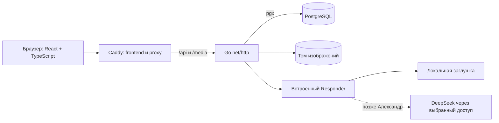

# 05. Архитектура, окружение и проверки

**Дата:** 28.10.2026. **Статус:** технические решения для реализации; фактические проверки каркаса отдельно в [части 1](../02-foundation/README.md).

**Кому обязательно прочитать:** разработчику сайта и тестировщику.
**Какие разделы особенно важны:** PM — 1, 6–8; разработчику бота — 1 и граница из контракта; content manager — критерии редактора в §7.

## 1. Компоненты и граница текущей карточки

Один Go-процесс, PostgreSQL и Caddy; React собирается Vite в статические файлы Caddy. Для разработки возможен Vite dev server с прокси на Go. Нет Redis, очереди, отдельного сервиса модели и доступа фронтенда к ключу поставщика. `/media` всегда проходит через Go.

Часть 1: исходники базовых проектов, pgx, миграции/справочники, контейнеры, технические health endpoints, внутренний интерфейс/заглушка. Часть 2 и дальнейшие этапы: реальные auth/права/предметный API, очиститель медиа, рабочие экраны, интеграция. Нельзя объявлять последующие сценарии реализованными по этой схеме.

## 2. Авторизация и права — проект для части 2

Выбраны непрозрачные серверные сессии в cookie: для пяти аккаунтов это позволяет отозвать вход без JWT и отдельного сервиса. Случайный токен 32 байта, в БД только SHA-256; cookie HttpOnly/SameSite=Lax/Path=/ и Secure при HTTPS. Абсолютный срок 7 суток без скрытого продления, отзыв на выходе/сбросе пароля. Local HTTP допустим только на localhost, Secure=false задаётся явно для него. SameSite не заменяет CSRF: проверяем точный Origin и токен сессии в X-CSRF-Token, не разрешаем сторонний CORS. Login защищён проверкой Origin, JSON и лимитом попыток; фиксируем APP_ORIGIN.

Пароли: Argon2id, случайная соль 16 байт, ключ 32 байта, рабочие параметры 64 МиБ/3 прохода/2 потока с измерением на целевой машине, PHC-строка включает параметры. CLI создания/сброса в части 2 читает пароль без эха/stdin, не из аргумента командной строки и не из SQL-миграции; 12–128 символов/≤512 байт. После сброса отзываются все сессии. Публичных восстановления и регистрации нет.

Автор определяется только сессией. Для update/delete читаем и блокируем строку, сравниваем author_id. Проверка через UI недостаточна. При входе пользователя/сбросе учитывать is_active; неактивный аккаунт не может иметь сессию с действующими правами. В части 1 сидируются пять неактивных записей без hash. Для размещения отделить владельца схемы/мигратора от роли приложения с DML-правами; локальная Compose-роль сейчас учебная, не готовая production-конфигурация.

## 3. Изображения: хранение и отказоустойчивость

БД и файлы — разные ресурсы, общей атомарной транзакции диска и PostgreSQL нет. Поэтому используем состояния и повторяемую уборку:

1. Приём multipart с MaxBytesReader; размер ≤5 МиБ, PNG/JPEG/WebP, DecodeConfig до декодирования, ≤20 Мп. Полное декодирование проверяет повреждения; лимит параллельных декодирований 2, чтобы ограничить память. Не доверять имени/MIME. Файл изображения не выполняется, SVG исключён. Метаданные файла не используются для путей. Публикуемые байты — проверенный оригинал; личные EXIF при необходимости удаляет автор до загрузки, автоматическая обработка не обещана.
2. ID и storage_key уникальны. После проверки содержимого создать запись staging и lease=now()+24h, сохранить файл в `<MEDIA_DIR>/.incoming/<uuid>` с O_EXCL, fsync, атомарно переименовать в финальный ключ без замены существующего файла, fsync каталога; обновить запись на ready. Весь этот путь укладывается в ограниченный тайм-аут загрузки (30 секунд).
3. При сбое запись staging/файл не выдаются. Обслуживание удаляет staging старше часа; максимальная длительность загрузки меньше этого срока. Сиротские файлы без записи удаляются только старше 24 часов и при отсутствии активных загрузок (режим обслуживания), либо после остановки API. Никогда не сканировать и удалять неизвестные файлы конкурентно с загрузкой без такого барьера.
4. ready-файл публичен только при наличии publication_media. Иначе доступен владельцу до lease_until. В открытом редакторе обновляем аренду каждые 10 минут, при возвращении на вкладку/перед сохранением. При долгом сне/потере сети >24 часов восстановление не гарантируется: текст остаётся в памяти, файл может потребовать повторной загрузки.
5. Связи извлекает сервер из Markdown, проверяет владельца, ready и срок. Привязка и уборка блокируют одну строку media; подробный порядок — [БД §6](02-Схема-БД.md). Пока файл используется хотя бы одной статьёй, он не удаляется. Снятие последней связи даёт минимум 24 часа до уборки; сохраняется более длительная действующая аренда.
6. Уборка каждый час: отметить deleting в транзакции только после повторной проверки отсутствия связей; удалить файл; удалить запись. Ошибка файловой системы оставляет deleting для повторной попытки. Отсутствующий файл при удалении считается уже удалённым. Выдача не делает скрытой очистки.

Замена изображения всегда новый файл/URL. Старая публикация со старым изображением действует до commit. Удаление статьи не вызывает немедленного физического удаления, поэтому сбой диска не создаёт полусохранённый материал. Ни аренда, ни staging не хранят текст отчёта.

## 4. Безопасное отображение и журнал

Общий React Markdown-рендерер для чтения и preview: react-markdown + remark-gfm + remark-math + rehype-katex, без rehype-raw, KaTeX trust=false. Ограничить ссылки http/https и внутренними маршрутами, изображения — `/media/<uuid>`, запретить javascript/data URL. Внешние ссылки открываются с noopener/noreferrer. Сырые теги не исполняются. Конкретные версии подключаются на этапе рендерера, не включаем весь интерфейс сейчас.

Go: JSON limits, тайм-ауты, parameterized SQL, ограничение пула, graceful shutdown. Логи: request_id, маршрут, статус, длительность, технический код; без паролей, cookie, CSRF, текста чата/статей и ключей. Ошибки 500/503 пользователю без внутренней строки драйвера. Пароль БД и ключи не помещаются во frontend env (VITE_* видны браузеру).

## 5. Резервное копирование и восстановление

Обязательная будущая процедура, не объявлена реализованной автоматизацией части 1. Для маленького сайта выбираем короткое окно обслуживания: запретить все записи (включая загрузку, аренду и уборку), дождаться активных операций и остановить Go/очиститель; PostgreSQL продолжает работать. Снять `pg_dump -Fc`, архив всего media_data и манифест с датой UTC, версией миграций/кода, SHA-256 архивов и количеством файлов. Оба архива принадлежат одному окну. Затем возобновить API. Один только живой tar каталога PostgreSQL не заменяет pg_dump.

Копии хранить вне исходного Docker-хоста, с ограниченным доступом и шифрованием. Рабочее предложение: ежедневно, 7 ежедневных и 4 недельных копии; место/ответственного/допустимое окно согласовать перед размещением. Это эксплуатационные параметры, не подтверждённый бюджет/хостинг.

Восстановление: новый изолированный Compose project и пустые тома; та же major-версия PostgreSQL, тот же код/миграции. API остановлен. Восстановить pg_restore в пустую БД, media в том с правильным владельцем, сверить hash/список ключей. Удалить сессии и технические квитанции восстановления, затем запускать; применить только последующие проверенные миграции. Проверить статьи, изображения и права, затем разрешить записи. Не тестировать восстановление поверх единственной рабочей копии. До публичного запуска Андрей должен выполнить полный тест восстановления по реальным файлам.

## 6. Локальное окружение и размещение позднее

Сейчас `http://localhost:8080`, только loopback host-port, без домена/модели. Compose: db с healthcheck; одноразовый migrate ждёт db, api ждёт успешный migrate, web ждёт healthy api. Том PostgreSQL 18 монтируется в `/var/lib/postgresql`, media — в `/var/lib/nir/media`; обычный down сохраняет тома. Применённые SQL не редактируются: добавляется следующая миграция. Миграции — явная служебная команда, не побочное действие любого HTTP-запроса.

Будущее: Linux-хост с Docker Compose, Caddy 80/443 и HTTPS для домена, приватная сеть БД/API, резервная копия отдельно, APP_ORIGIN с HTTPS/Secure-cookie, ограниченные роли БД. Поставщик модели конфигурируется сервером после согласования Александром. Конкретный хостинг/домен/тариф не выбирается. Размещение нельзя считать готовым по локальному запуску.

## 7. Приёмка первой версии (план, не результаты тестов)

| Сценарий | Ожидаемый результат / привязка |
| --- | --- |
| Гость ищет русский и технический термин | заголовок/содержимое, буквальные %/_; AND-фильтры и стабильный порядок; REQ-CATALOG |
| Даты на границе суток Москвы | обе включённые даты, верный UTC-интервал, одна подпись «Обновлено» |
| Вход, выход, истечение, CSRF | 401/403, cookie-флаги, отзыв сессии, отсутствие обхода прямым запросом |
| Ручная публикация и повтор после потери ответа | одна статья, правильный автор/дата; одинаковая квитанция |
| Две вкладки обновляют статью | вторая получает 412, текст не теряется; новая редакция после commit |
| Чужие PUT/DELETE и подмена author_id | 403/400, ни статья, ни связи не меняются |
| Подтема чужого направления/несуществующие IDs | 422, нет противоречивых данных |
| PNG/JPEG/WebP, одинаковые имена, повреждения/20Мп/5МиБ | проверка байтов, уникальные URL, ошибки не стирают редактор |
| Временное изображение владельцем/гостем/другим автором | 200/404/404; после публикации публично |
| Замена/удаление/файл в двух статьях | старый файл жив до сохранения; другая связь защищает от уборки |
| Уборка одновременно с публикацией и сбой диска | блокировки исключают потерю принятого файла; повторяемые deleting/staging |
| Markdown с HTML/опасными URL | скрипт не выполняется; одинаково в preview и статье |
| Бот: перенос, применение, отмена, ошибка | без дополнительной генерации на перенос; см. полный контракт §6 |
| Переключение вкладок/ошибка сети | состояние в памяти сохраняется, нет скрытого автосохранения |
| Телефон/клавиатура | все обязательные действия и подтверждения доступны |
| Пересоздание контейнеров/восстановление | данные/изображения сохранны, тест восстановления на изолированных томах |

Тестировщик проверяет happy path и ошибки на каждом соответствующем этапе. Каркас проверяется отдельным меньшим набором: сборка, миграции, pgx health, повтор применения, ограничения SQL, постоянство томов. Нельзя запуском health зачесть права или генерацию.

## 8. Решения, допущения и согласования

Приняты пользователем: стек, пять аккаунтов/каталог заранее, собственное авторство, единая дата, отсутствие черновиков, локальный запуск, отдельный ответственный за модель (Q01–Q10). Технически выбраны здесь: cookie-сессии/Argon2id, UUID/ETag/квитанции, ILIKE+pg_trgm, пагинация, временная аренда и состояния файлов. Это рабочие решения разработчика в пределах поручения, не новые ответы пользователя.

Открыто: подтверждение контракта Александром; макеты/вычитка каталога Екатериной; сроки и оценка медиа/удаления Егором; доступ участников на запись в GitHub после появления их аккаунтов; будущие размещение, модель и резервные копии. Независимая часть каркаса выполняется сейчас.

Проверка согласованности перед частью 1: экраны используют те же URL/поля API; направление выводится из подтемы; дата одна; публикация отдельно от генерации; картинки защищены и без серверного текста; технический revision_key не история; контракт имеет один основной файл. Существенных продуктовых противоречий не выявлено. Более широкий старый этап 2.3.2 явно разделён текущим поручением; схемы экранов здесь словесные, визуальные макеты ещё за Екатериной.

## 9. Официальные источники технических решений

Проверены при подготовке: [Vite: создание проекта и Node](https://vite.dev/guide/), [React: Vite с TypeScript](https://react.dev/learn/build-a-react-app-from-scratch), [pgxpool](https://pkg.go.dev/github.com/jackc/pgx/v5/pgxpool), [PostgreSQL pg_trgm](https://www.postgresql.org/docs/current/pgtrgm.html), [Compose: порядок запуска](https://docs.docker.com/compose/how-tos/startup-order/), [Docker PostgreSQL: тома версии 18](https://github.com/docker-library/docs/blob/master/postgres/README.md), [Caddy reverse_proxy](https://caddyserver.com/docs/caddyfile/directives/reverse_proxy). Точные установленные версии и результаты сборки фиксируются в части 1 и lock-файлах; слово «актуальный» не заменяет lock.
